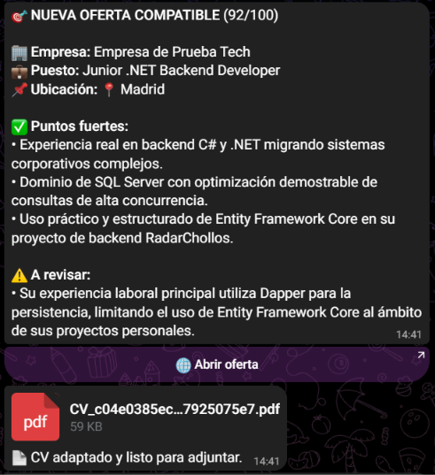

# CareerCopilot

Bot que busca ofertas de trabajo, las puntúa contra un perfil profesional usando la API de Gemini y avisa por Telegram. Si una oferta supera el umbral, genera un CV de una página en PDF adaptado al puesto y lo manda adjunto al mensaje.

Lo escribí para dejar de repasar portales a mano cada mañana. Sigue siendo eso: una herramienta de uso personal, no un producto.

<p align="center">
  
</p>

## Cómo funciona

Cada ciclo recorre el mismo camino:

1. **Ingesta.** Consulta Tecnoempleo, el endpoint público de LinkedIn, Adzuna, InfoJobs, Remotive y cualquier feed RSS que añadas en `BotConfig:Feeds`.
2. **Filtros locales.** Antes de gastar una llamada al modelo, descarta lo que no encaja: palabras obligatorias, palabras excluidas y ubicación (Madrid o remoto, configurable).
3. **Puntuación.** Gemini recibe la oferta y el perfil, y devuelve una nota de 0 a 100 con su justificación y una propuesta de CV.
4. **Guardarraíl.** `CvSanitizer` revisa el CV generado y elimina cualquier término técnico que no aparezca en el perfil. Si el modelo se inventa una tecnología, no llega al PDF.
5. **Compilación.** `CvCompilerService` genera el documento Typst, lo compila y cuenta las páginas resultantes.
6. **Aviso.** Se envía la oferta, la nota y el PDF por Telegram.

El worker corre en segundo plano cada `CheckIntervalMinutes` minutos y procesa como máximo `MaxOffersPerCycle` ofertas por vuelta, para no agotar la cuota del modelo.

## El CV de una página

Es la parte que más vueltas dio. El modelo no controla el formato: devuelve contenido estructurado y el compilador decide cómo entra en un A4.

`CvCompilerService` recorre una escalera de intentos (`FitLadder`): empieza con el cuerpo de letra más grande y va bajando, recortando bullets por prioridad entre intento e intento. Cada intento escribe el `.typ`, lo compila con la CLI de `typst` y cuenta las páginas con PdfPig.

Si ninguno de los intentos cabe en una página, **borra el PDF y no envía nada**. Un CV de dos páginas es peor que no tener CV, así que el fallo es explícito: queda en el log y el mensaje de Telegram no sale.

Antes de compilar, dos pasos fijan lo que el modelo no debe tocar: `CoalesceSections` fusiona secciones duplicadas y `ApplyAnchors` sobrescribe la cabecera con el nombre y los enlaces reales del perfil. Así el PDF nunca sale sin nombre porque al modelo le apeteciera omitirlo.

## Stack

| Pieza | Qué uso |
|---|---|
| Lenguaje | C# / .NET 10 |
| Bot | Telegram.Bot |
| Modelo | API de Gemini |
| Persistencia | SQLite con `Microsoft.Data.Sqlite` |
| PDF | Typst (CLI) + PdfPig para contar páginas |
| Feed | `System.ServiceModel.Syndication` |
| Despliegue | Docker en Render, con `/health` sondeado por UptimeRobot |

## Estructura

```
CareerCopilot/            servicio principal (worker + bot)
  Endpoints/              rutas HTTP: / y /health
  Models/                 entidades, configuración y modelo del CV
  Repositories/           acceso a datos sobre SQLite
  Services/               scraping, scoring, sanitizer, compilador, notificaciones
  Workers/                CareerCopilotWorker, el proceso en segundo plano
tests/CareerCopilot.Tests/  tests con xUnit
```

## Ejecutar en local

Necesitas el SDK de .NET 10 y la CLI de `typst` en el `PATH`, porque el compilador la invoca como proceso externo.

```bash
git clone https://github.com/idarkar3000/CareerCopilot.git
cd CareerCopilot
dotnet restore
dotnet run --project CareerCopilot
```

Antes de arrancar, copia `CareerCopilot/appsettings.example.json` a `CareerCopilot/appsettings.Development.json` y rellena ahí tus claves y tu perfil. Ese archivo está en `.gitignore`, así que en un clon limpio no existe.

Si falta algún dato obligatorio, el arranque lo avisa por log con el nombre exacto de la variable que hay que crear. Los tests se lanzan aparte:

```bash
dotnet test
```

## Docker

El `Dockerfile` compila la app y descarga la CLI de Typst en la imagen final, para que el contenedor no dependa de nada instalado en el host.

```bash
docker build -t careercopilot .
docker run --env-file .env -p 8080:8080 careercopilot
```

## Configuración

Todo cuelga de la clave `BotConfig`. En producción las claves van como variables de entorno, con `__` para anidar (`BotConfig__GeminiApiKey`).

| Ajuste | Para qué sirve |
|---|---|
| `GeminiApiKey` | Clave de la API de Gemini. Obligatoria. |
| `TelegramBotToken` | Token del bot. Obligatorio. |
| `TelegramChatId` | Chat al que se envían los avisos. |
| `MinScoreThreshold` | Nota mínima para que una oferta genere CV. Por defecto 60. |
| `CheckIntervalMinutes` | Cada cuánto se lanza un ciclo. Por defecto 60. |
| `MaxOffersPerCycle` | Tope de ofertas procesadas por vuelta. Por defecto 12. |
| `RequiredKeywords` / `ExcludedKeywords` | Filtros previos al modelo. |
| `LocationFilter` | Ubicaciones aceptadas y palabras que cuentan como remoto. |
| `SearchQueries` | Términos que se lanzan contra cada fuente. |
| `Candidate` | Nombre, contacto, enlaces y plantilla del nombre del PDF. |
| `CandidateProfileFile` | Ruta al perfil profesional. Por defecto `prompts/profile.md`. |

**El perfil no está en el repositorio.** `prompts/profile.md` contiene datos personales reales y está en `.gitignore`, así que cada instalación pone el suyo. `CandidateProfile` solo se usa como texto de respaldo si ese archivo no existe.

## Comandos de Telegram

| Comando | Qué hace |
|---|---|
| `/start`, `/help` | Ayuda. |
| `/run` | Lanza un ciclo completo ahora mismo. |
| `/scan <término>` | Búsqueda puntual, sin esperar al siguiente ciclo. |
| `/cv <id>` | Regenera el CV de una oferta con Gemini. |
| `/cvlocal <id>` | Genera el CV sin llamar al modelo, solo con el perfil. |
| `/unmark <id \| título \| url>` | Devuelve una oferta a pendientes para que se reevalúe. |
| `/stats` | Ofertas evaluadas, coincidencias, media de afinidad y últimas 24 h. |
| `/status` | Estado del bot y del escaneo en curso. |
| `/test` | Prueba de extremo a extremo: Gemini, Typst, PDF y Telegram. |
| `/addjob`, `/removejob`, `/jobs` | Gestión de términos de búsqueda. |
| `/addrequired`, `/removerequired` | Palabras que una oferta debe contener. |
| `/addexcluded`, `/removeexcluded` | Palabras que la descartan. |
| `/filters` | Ver los filtros activos. |
| `/threshold <0-100>` | Cambiar el umbral mínimo. |

Los filtros se pueden cambiar desde el propio chat sin reiniciar el servicio.

## Decisiones de diseño

**Los filtros deterministas van antes que el modelo.** Una llamada a Gemini por oferta es cara y lenta. Descartar por palabra y ubicación en local reduce el gasto a una fracción y evita puntuar ofertas que nunca iban a interesar.

**El sanitizer existe porque el modelo adorna.** Cuando le pides un CV, tiende a añadir tecnologías que suenan bien y no están en el perfil. `CvSanitizer` compara el resultado con el perfil y tira lo que no encuentra. Es más barato revisar una lista de tokens que confiar en el prompt.

**El formato del CV no lo decide el modelo.** Si el modelo maquetara, cada oferta saldría distinta y no habría forma de garantizar una página. El modelo devuelve datos, el compilador decide el diseño.

**SQLite en lugar de un motor cliente-servidor.** El volumen es de decenas de ofertas al día y el despliegue es un contenedor único. Un Postgres aquí sería infraestructura sin uso.

## Limitaciones

- **Sin CI.** Los tests se lanzan a mano con `dotnet test`. Son pocos y cubren el sanitizer, el parser de secciones y la carga del perfil.
- **El scraping depende del HTML de las fuentes.** Tecnoempleo y LinkedIn se leen con expresiones regulares sobre la página. Si cambian el marcado, esa fuente deja de devolver resultados sin avisar.
- **Sin reintentos ante bloqueo.** Si una fuente responde con un captcha o un 429, ese ciclo se queda corto y no se recupera hasta el siguiente.
- **Un solo usuario.** `TelegramChatId` es un chat fijo, no hay gestión multiusuario.
- **Dos servicios son grandes.** `CvCompilerService` y `TelegramNotifierService` concentran demasiada responsabilidad y son los primeros candidatos a partirse.

## Licencia

MIT. Mira [LICENSE](LICENSE).
